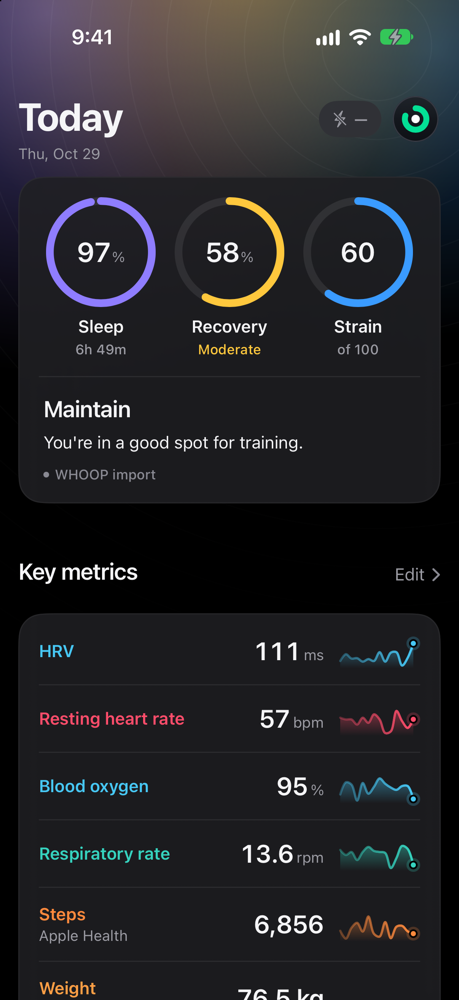
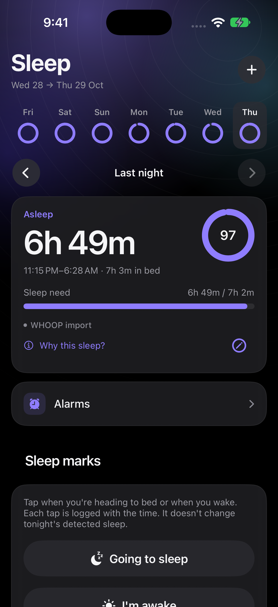
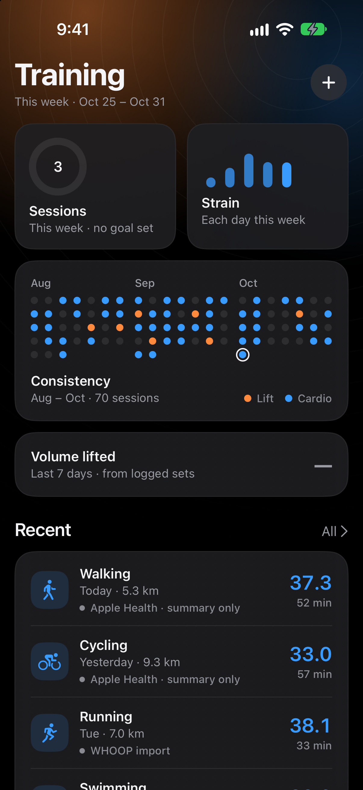
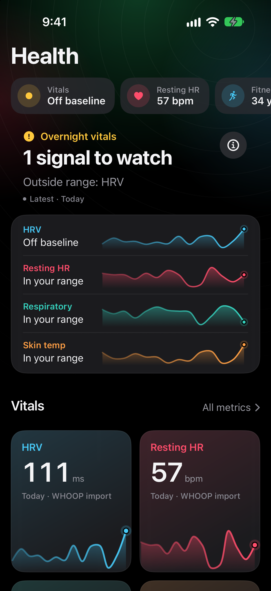
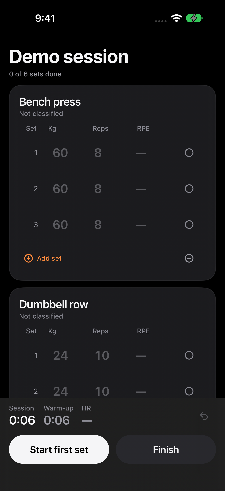
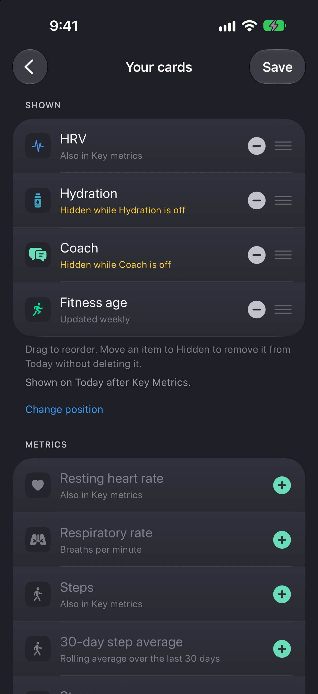

# NOOP for iPhone

**A redesigned iPhone home for your WHOOP data.**

Sleep, Recovery, and Strain at a glance. A training log that keeps your lifting sets.
An optional Coach alongside your daily numbers.

Built on [NOOP](https://github.com/ryanbr/noop), this version focuses on the iPhone
experience: redesigned screens, a customizable dashboard, workout imports, ChatGPT
Coach, widgets, and Live Activities.

[Build and run](docs/GETTING_STARTED.md) · [Project status](docs/PROJECT_STATUS.md) ·
[Contributing](CONTRIBUTING.md) · [Credits](ATTRIBUTION.md)

## A look at the app

<table>
  <tr>
    <td align="center"><strong>Today</strong></td>
    <td align="center"><strong>Sleep</strong></td>
    <td align="center"><strong>Training</strong></td>
  </tr>
  <tr>
    <td></td>
    <td></td>
    <td></td>
  </tr>
  <tr>
    <td align="center"><strong>Health</strong></td>
    <td align="center"><strong>Lifting</strong></td>
    <td align="center"><strong>Your Cards</strong></td>
  </tr>
  <tr>
    <td></td>
    <td></td>
    <td></td>
  </tr>
</table>

*Screenshots of this iPhone redesign, captured in Simulator with synthetic demo data.*
[Capture details](docs/assets/iphone/README.md)

## The work in this version

### A daily view built around the phone

Today brings the three daily rings, metric sparklines, recent activity, and data-source
captions together. Open Recovery to see what shaped the result against a personal
baseline, or Strain to explore the day's effort and heart-rate zones.

Sleep has a seven-night overview, a sleep-need comparison, stages, and a detailed
timeline. Health brings overnight vitals, baseline comparisons, and individual metric
history into the same visual language.

The navigation is organized around **Today, Sleep, Training, and Health**, with a
separate Coach tab and Profile access from the avatar.

### Make Today your own

**Your Cards** lets you choose and reorder metrics and shortcuts, then move the section
to the place that suits your day. The editor explains duplicate metrics, hidden sections,
and cards that need an optional feature enabled. Key metric rows and cards share the
same values and source labels.

The redesign includes a dark palette, score-tinted backgrounds, consistent typography,
and layouts adapted for larger text. Reduce Motion is respected. **Use classic Today**
keeps the earlier interface available.

### Keep the lifting details

Training brings workout history, weekly sessions, consistency, and logged lifting volume
into one place. Paste supported workout text, review the parsed result, then save the
exercises, sets, repetitions, weights, and notes. Hevy CSV import brings existing lifting
history into the same workflow.

Apple Health workouts remain labelled **summary only**; pasted or Hevy imports retain
full sets. CSV imports skip duplicate start times rather than reconciling later edits.
No direct Hevy or Strava account sync is included.

### Coach with a choice of connection

The native Coach view adds **ChatGPT subscription sign-in** for eligible accounts,
alongside the existing API-key and Custom providers. Sign-in, use of the account's plan
allowance, and consent to share health summaries are separate choices.

Conversations and summaries go directly to the selected provider. Coach can stay
unconfigured while collection and local analytics continue. Subscription availability
depends on provider authorization and account eligibility.

### Useful beyond the main screen

Home Screen and Lock Screen widgets present key readings and recent sleep. The steps
widget shows Apple Health totals when available, falling back to a labelled band
estimate, with a chosen goal. Live Activities cover heart rate, lifting, and sync.
The redesign carries through to these surfaces, while keeping their existing
identities and stored preferences.

## Try it from source

The development focus is **iPhone with an owned WHOOP 4.0 strap**. A Mac with
**Xcode 26+** and **XcodeGen 2.45+** is needed; the app targets **iOS 17+**.

```bash
git clone --branch personal/iphone-baseline https://github.com/cyrilbhau/noop-fork.git
cd noop-fork
bash Tools/personal/ios.sh check
```

Follow [Getting started](docs/GETTING_STARTED.md) to configure a unique signing identity
and run the app and widgets. The Xcode scheme is **NOOPiOS** and the installed display
name is currently **NOOP Cyril**. Distribution is from source; this adaptation has no
signed public download or TestFlight release.

Collection, imports, storage, and analytics run on the device. Optional Coach requests
have their own consent controls. The inherited automatic update check contacts GitHub
and currently reports upstream NOOP releases; it can be disabled in Settings.
See the [network inventory](docs/PRIVACY_SECURITY.md#11-network-paths-canonical-inventory).

## Current limits

This is a development project. Reliable phone-free step counting, multi-night
background collection, widget freshness, and backup/restore still need device
acceptance. WHOOP 4.0 steps are motion estimates, blood oxygen is not measured from
that strap, and absolute skin-temperature accuracy is unsupported.

Live HealthKit reads are limited to Steps and workout summaries, with no Health
writes or physiological imports. Today’s Steps detail keeps the sources separate
and offers a counted phone-free walk check; a passing trial applies to that walk,
not general step accuracy. The familiar score labels use NOOP's independent calculations.

[Project status](docs/PROJECT_STATUS.md) records the evidence and remaining checks.
Permission for some earlier inherited source and the privacy of existing Git history
still need resolving before public redistribution; see the
[publication review](docs/PUBLICATION_REVIEW.md).

## Credits and license

This work builds on **[NOOP by @ryanbr and its contributors](https://github.com/ryanbr/noop)**,
starting from [`8e4b0c16`](https://github.com/ryanbr/noop/commit/8e4b0c16e7640607600fa6bde5424095eba6034e).
Their protocol, collection, storage, import, and analytics foundation makes this iPhone
adaptation possible. The retained history and [attribution](ATTRIBUTION.md) preserve
that authorship and earlier community credits.

The source retains [PolyForm Noncommercial 1.0.0](LICENSE) and the upstream required
notice. Dependencies retain their own terms; see [NOTICE](NOTICE) and
[dependency licenses](LICENSES/README.md).

Independent of WHOOP, Inc. and OpenAI. Not endorsed by either company and not a
medical device. See [DISCLAIMER.md](DISCLAIMER.md).
